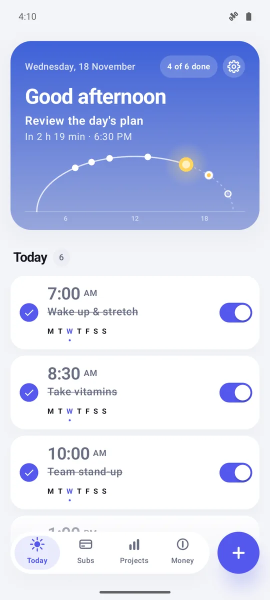
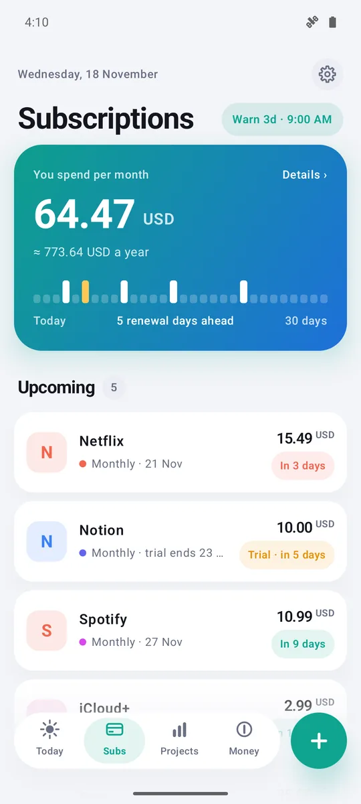
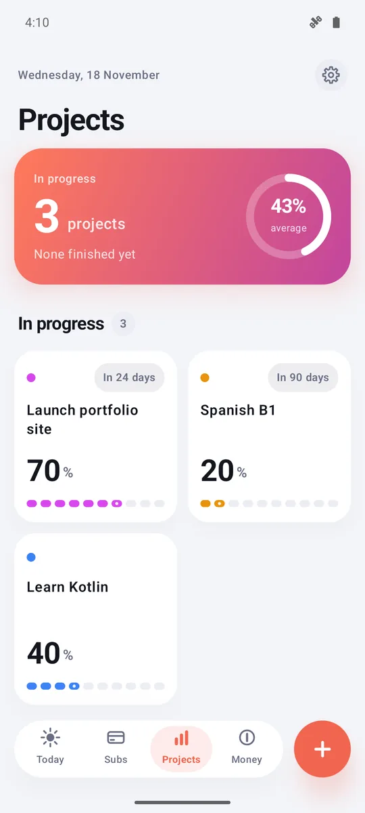
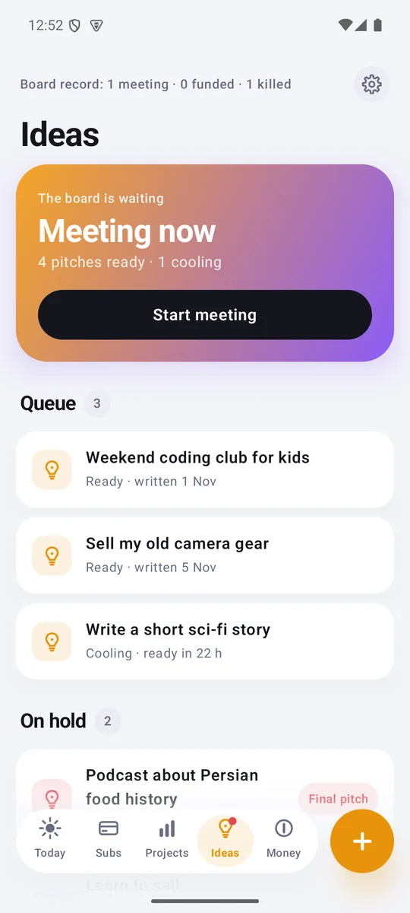
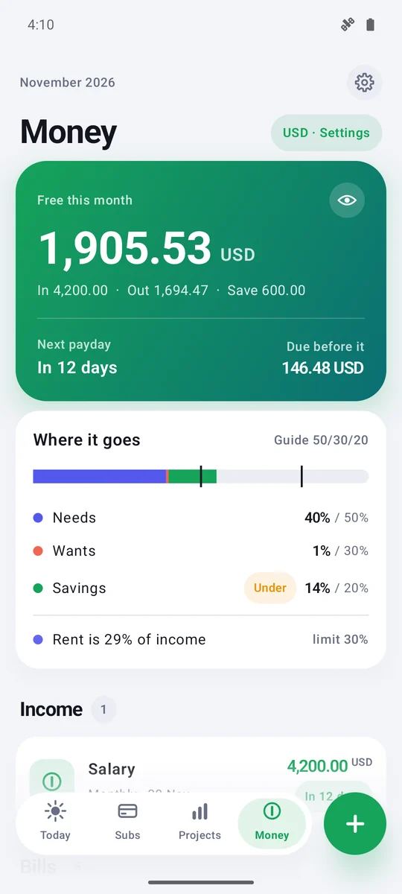
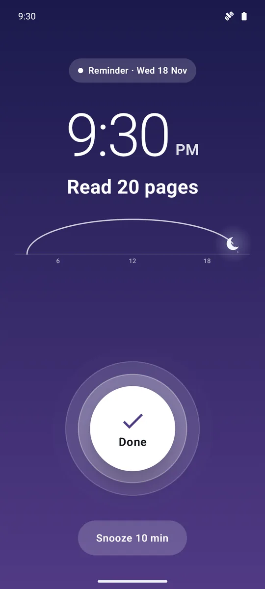
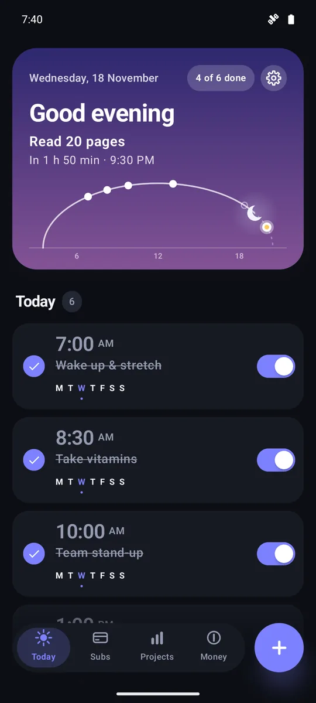
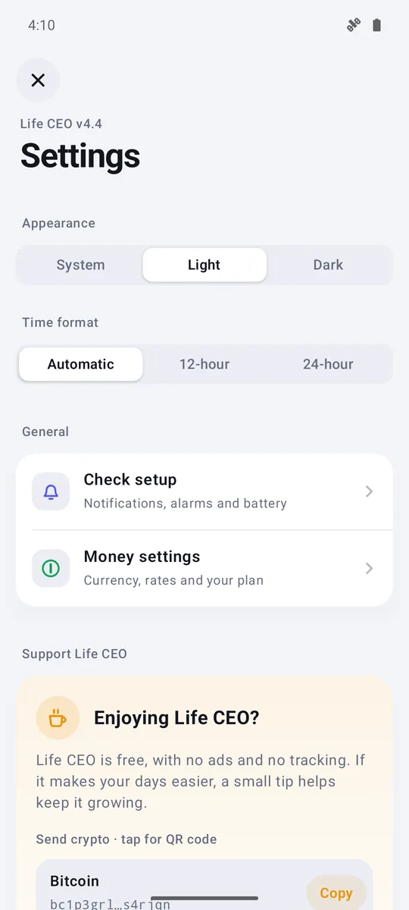

<p align="center">
  
</p>

<h1 align="center">Life CEO</h1>

<p align="center">
  <b>Run your day like a company.</b><br>
  Reminders that actually ring, subscriptions, projects and your monthly money plan, in one private Android app.
</p>

<p align="center">
  <a href="https://github.com/funnypar/LifeCEO/releases/latest/download/LifeCEO.apk"><b>⬇ Download LifeCEO.apk</b></a>
  &nbsp;·&nbsp;
  <a href="https://funnypar.github.io/LifeCEO/">Website</a>
  &nbsp;·&nbsp;
  <a href="CHANGELOG.md">Changelog</a>
</p>

<p align="center">
  Android 12+ · Free · No ads · No account · No internet permission
</p>

<p align="center">
  
  
  
  
  
</p>

---

## What it does

### ☀️ Today: reminders that won't let you forget
- Daily tasks with a time and the days of the week they repeat on.
- When it's time, a **full-screen alarm** rings, even on the lock screen and through silent / Do Not Disturb.
- **Done** marks it finished for today. **Snooze** rings again in 10 minutes. Ignore it for 5 minutes and you get a "Missed" notification.
- A sky card that follows the real time of day shows your next reminder, a countdown, and your whole day as an arc.

### 💳 Subs: know before you're charged
- Track every subscription and free trial: price, currency, billing cycle, next renewal.
- Get a notification a few days before a renewal (default 3 days at 09:00), and **before a free trial turns into a paid one**.
- See what you spend per month and per year, a 30-day renewal strip, and a spending breakdown by category.

### 📊 Projects: see how far along you are
- Keep the projects you care about, with an optional deadline.
- Tap a 10-step bar to update progress. Projects you haven't touched in a week get a gentle "idle" hint.

### 💡 Ideas: every idea gets a decision
- Write ideas down the moment they come: from a Quick Settings tile, the app-icon shortcut, or the tab itself. Add a note or a voice memo (up to 2 minutes, kept on your phone).
- Once a week the **board meeting** shows your pitches one by one. **Fund** turns an idea into a project, **Hold** brings it back next week (three holds and it's a final pitch), **Kill** sends it to the graveyard, where you can resurrect it.
- A **wildcard round** draws two old ideas and asks: what if these were one thing?

### 💰 Money: your monthly plan
- Add your salary and recurring bills (rent, utilities, loans, insurance…).
- See **what's free this month** after bills, subscriptions and your savings goal.
- Check needs / wants / savings against the 50/30/20 guideline, and rent against a 30% limit.
- Works in any currency, including Toman and Turkish lira, with exchange rates you set yourself.

### ⚙️ Settings
- Light, Dark or System theme. 12-hour, 24-hour or automatic time format.

<p align="center">
  
  
  
</p>

---

## Install

Life CEO isn't on the Play Store. You install the APK file directly ("sideloading"). It takes about a minute.

1. **Download** [`LifeCEO.apk`](https://github.com/funnypar/LifeCEO/releases/latest/download/LifeCEO.apk) on your Android phone.
2. **Open** the downloaded file from your notifications or the Files / Downloads app.
3. If Android says *"For your security, your phone is not allowed to install unknown apps from this source"*, tap **Settings**, turn on **Allow from this source**, and go back.
4. Tap **Install**, then **Open**.
5. On first launch, Life CEO asks for a few permissions so alarms can ring reliably. Tap through each one (see below for why).

> **Play Protect warning?** Google may say the app is from an unknown developer, because it isn't distributed through the Play Store. Tap **More details → Install anyway**.

### Updating
Download the new `LifeCEO.apk` from [Releases](https://github.com/funnypar/LifeCEO/releases) and install it over the old one. **Your data stays.** Don't uninstall first, because uninstalling deletes your data.

> Coming from **Daily**? Life CEO is the same app with a new name. Install it over Daily and everything carries over.

### Check the download (optional)
Each release lists the APK's SHA-256 checksum. On a computer:

```bash
shasum -a 256 LifeCEO.apk
```

---

## Permissions and why

| Permission | Why Life CEO needs it |
|---|---|
| Notifications | Subscription, trial and bill warnings, board meetings, and "Missed" reminders |
| Alarms & reminders (exact alarms) | To ring at exactly the time you set, not "around then" |
| Full-screen notifications | To show the alarm over the lock screen |
| Ignore battery optimization | So the phone doesn't put alarms to sleep |
| Run at startup | To re-arm your alarms after the phone restarts |
| Vibrate, keep awake, foreground service | To ring and vibrate until you tap Done or Snooze |
| Microphone (optional) | Only to record a voice memo on an idea. Asked the first time you tap record |

**There is no internet permission.** The app can't send your data anywhere.

---

## Privacy

- Everything is stored **only on your phone**, in the app's private storage.
- No account, no cloud, no analytics, no ads, no tracking.
- Uninstalling the app deletes all of its data.

---

## FAQ

**My alarm didn't ring.**
Open Settings → **Check setup** and make sure every item is allowed. Some phones (Xiaomi, Huawei, Samsung, Oppo…) also have their own battery saver. Set Life CEO to "No restrictions" / "Unrestricted" there.

**Does it ring in silent mode?**
Yes. It uses the alarm volume, like your clock app.

**Is there an iPhone version?**
No, Android only (Android 12 or newer).

**Can I back up or move my data to a new phone?**
Not yet. Data lives on the phone only.

**Why isn't it on the Play Store?**
It's a small personal project. Sideloading keeps it free and simple.

---

## Support & contact

Life CEO is free, with no ads and no tracking. If it makes your days easier, you can leave a tip from **Settings → Support Life CEO** inside the app.

- Feedback & bugs: [open an issue](https://github.com/funnypar/LifeCEO/issues), or use **Settings → Email** in the app
- Telegram: [@moppano](https://t.me/moppano)
- GitHub: [@funnypar](https://github.com/funnypar)

<p align="center"><sub>Made by MOPANO</sub></p>
